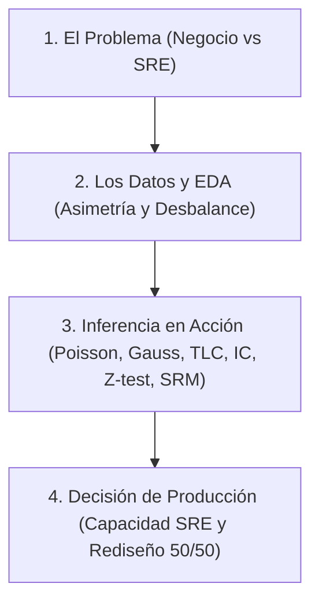

# Guion de Exposición y Marco Teórico: Inferencia Estadística y Decisión en Producto

> **Documento de Apoyo para los Expositores**  
> **Tema:** Inferencia Estadística aplicada a Sistemas de Alta Concurrencia y Decisión de Producto  
> **Notebook de Presentación:** [`Inferencia_AB_Testing.ipynb`](Inferencia_AB_Testing.ipynb)  
> **Dataset:** Marketing A/B Testing (Kaggle) — 588.101 usuarios · 22 MB  
> **Expositores:** Yandris Rivera Torres (Software 7/1)

---

## 🎯 Estructura de la Presentación Oral (Pitch de 10-15 Minutos)

El objetivo de la exposición no es leer código ni recitar fórmulas abstractas, sino **demostrar con gráficos de alta resolución e impacto visual cómo la estadística inferencial transforma datos crudos en decisiones de ingeniería y negocio**.

---

## 📌 Pilar 1: El Problema a Resolver (¿Por qué estamos acá?)

### Lo que mostramos en pantalla:
- Tarjeta de contexto con el dilema: **Causalidad vs Ruido** y el dilema de **SRE (Saturación de Servidores)**.

### Lo que explicamos a la audiencia:
1. **El dilema de Producto:**
   - La empresa probó una creatividad publicitaria (`ad`) frente a un aviso de servicio público neutral (`psa`).
   - Los datos dicen que `ad` convirtió al $2.55\%$ y `psa` al $1.79\%$. La diferencia es de $+0.77$ puntos porcentuales.
   - La pregunta que definirá el presupuesto no es descriptiva (*"¿ganó el anuncio?"*), sino inferencial: **"¿Ese incremento de $+0.77$ pp es un impacto causal genuino que se mantendrá en producción, o es ruido estocástico que desaparecerá mañana?"**
2. **El dilema de Arquitectura e Infraestructura (SRE):**
   - El éxito del anuncio multiplica las visitas a la plataforma.
   - Si la infraestructura dimensiona sus microservicios asumiendo que el tráfico llega a una tasa media constante ($\lambda$), ¿cuántos minutos al día colapsarán las colas de peticiones por picos de tráfico?

---

## 📌 Pilar 2 & 3: Los Datos y Tratamiento (EDA Visual)

### Lo que mostramos en pantalla:
- **Gráfico 1:** Reparto muestral $96\%$ vs $4\%$ y tasa de conversión por grupo.
- **Gráfico 2:** Histograma con curva de densidad en escala logarítmica de `total ads` mostrando la **asimetría extrema ($\text{skew} \approx 7.4$) y cola pesada**.

### Lo que explicamos a la audiencia:
1. **La trampa del desbalance muestral:**
   - Hay $564.577$ usuarios en `ad` y apenas $23.524$ en `psa`.
   - Esto reduce drásticamente la potencia del grupo de control y enciende la primera alarma metodológica: **Riesgo de Sample Ratio Mismatch (SRM)**.
2. **La incompatibilidad normal de los datos crudos:**
   - Señalar en el gráfico la cola pesada que llega hasta $2.000$ anuncios vistos por un solo usuario (bots/scrapers).
   - *Punto clave:* **Los datos crudos NO son normales.** Aplicar la regla 68-95-99.7 a nivel de usuario individual es un error garrafal.

---

## 📌 Pilar 4: Aplicación de la Probabilidad e Inferencia

### 4.1 Poisson y Dimensionamiento de Servidores (SRE)
- **Gráfico en pantalla:** Patrón de llegadas por hora y comparativa de riesgo de desbordamiento (Capacidad $\lambda$ vs $\lambda + 2\sqrt{\lambda}$ vs $\lambda + 3\sqrt{\lambda}$).
- **Guion verbal:**
  - "El flujo de usuarios por hora se modela como un proceso de Poisson con $\hat{\lambda} \approx 24.500$ llegadas/hora ($408$ req/min)."
  - "El test LR rechaza una tasa constante ($p < 10^{-300}$): la demanda web es horaria y estacional."
  - "Si dimensionamos servidores solo para la media $\lambda$, la cola colapsa el **$49.6\%$ del tiempo ($714$ minutos al día)**."
  - "Para garantizar un SLA crítico ($< 2$ minutos de saturación al día), SRE debe aprovisionar un buffer de seguridad: $\lambda + 3\sqrt{\lambda} \approx 469$ req/min."

### 4.2 Teorema del Límite Central (TLC)
- **Gráfico en pantalla:** Panel de 4 histogramas ($n=5, 30, 200, 1.000$) donde la campana de Gauss emerge nítidamente de los datos asimétricos.
- **Guion verbal:**
  - "¿Por qué podemos usar la campana de Gauss si los datos crudos son asimétricos y la conversión es binaria ($0/1$)?"
  - "Por el **TLC**: la distribución de la media muestral $\bar{X}$ converge asintóticamente a $\mathcal{N}(\mu, \sigma^2/n)$."
  - "Con $n \ge 30$, la asimetría colapsa y la teoría nos autoriza matemáticamente a calcular intervalos y contrastes z."

### 4.3 Intervalos de Confianza y Contraste Z
- **Gráfico en pantalla:** Gráfico de error bars con los intervalos de confianza al $95\%$ y $99\%$, destacando la exclusión del valor $0$.
- **Guion verbal:**
  - "Fijamos $\alpha = 0.05$ estrictamente **antes** de mirar los datos."
  - "El Z-test arroja $Z = 7.37$ y un $p$-valor de $1.7 \times 10^{-13}$. Rechazamos formalmente $H_0$."
  - "El intervalo al $95\%$ para la diferencia es $[+0.60, +0.94]$ pp, y al $99\%$ es $[+0.54, +1.00]$ pp."
  - "El $0$ queda fuera en ambos: garantizamos con $99\%$ de confianza que la campaña aporta al menos $+0.54$ pp."

### 4.4 Calibración del Test y Potencia Estadística
- **Gráfico en pantalla:** Histograma de la simulación Monte Carlo con 2.000 experimentos nulos ($5\%$ exacto en las colas rojas) y curva de poder vs tamaño muestral.
- **Guion verbal:**
  - "Demostramos empíricamente que el test no miente: bajo $H_0$, la tasa de rechazo simulada es exactamente $5.0\%$."
  - "**La advertencia del poder:** Si hubiéramos corrido el experimento con solo $4.000$ usuarios por grupo (caso del sílabo), el poder habría sido de apenas **$66.5\%$**."
  - "Habríamos tenido $1$ probabilidad entre $3$ de descartar una campaña ganadora (Falso Negativo) o sufrir de la Maldición del Ganador (*Winner's Curse*)."

### 4.5 Multiplicidad y Optimización Horaria
- **Gráfico en pantalla:** Curva de conversión horaria con intervalos de confianza, destacando la franja pico (16:00 h) y la franja valle (02:00 h).
- **Guion verbal:**
  - "La prueba $\chi^2$ hora $\times$ conversión confirma dependencia ($p = 8.0 \times 10^{-77}$)."
  - "La hora 16:00 convierte al **$3.08\%$**, cuadruplicando la hora 02:00 (**$0.73\%$**)."
  - "Aplicamos corrección de Benjamini-Hochberg (FDR) para no caer en el sesgo de comparaciones múltiples."
  - "**Acción inmediata de Producto:** Concentrar el presupuesto en la ventana 15:00-18:00 h."

---

## 📌 Pilar 5: Directrices de Producción (Recomendaciones del Arquitecto)

### Resumen para proyectar:
1. **Rediseño del Experimento (Split 50/50):**  
   Corregir el reparto actual $96/4$ implementando un router determinista basado en hashing del ID de usuario (`hash(user_id) % 2`).
2. **Guardarraíl de SRM en Tiempo Real:**  
   Alerta automática en Prometheus/Grafana: si el test $\chi^2$ de proporciones da $p < 0.001$, pausar el experimento antes de interpretar conversiones.
3. **Aprovisionamiento SRE:**  
   Dimensionar clústeres para el pico de las 16:00 h con capacidad $\lambda + 3\sqrt{\lambda}$ ($469$ req/min por nodo).
4. **Regla de Parada Estricta:**  
   Prohibir detener el test antes de alcanzar el tamaño muestral precalculado para evitar sesgos de parada temprana (*peeking*).
